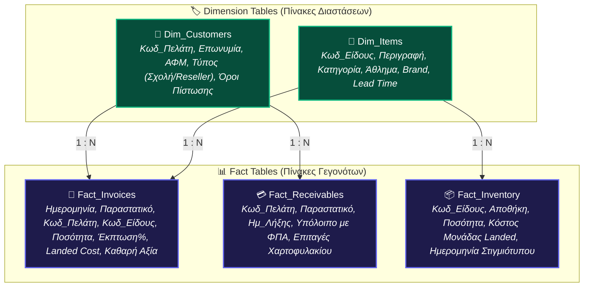
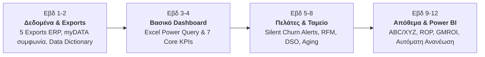

# 🥋 Olympus Sport Hellas — ERP Sales KPI & Analytics Hub

<div align="center">

[](https://karidasd.github.io/erp-kpi-hub/)

[](https://react.dev/)
[](https://www.typescriptlang.org/)
[](https://vitejs.dev/)
[](https://tailwindcss.com/)
[](LICENSE)
[](#)

**Διαδραστική διαδικτυακή πλατφόρμα επιχειρηματικής ευφυΐας (Commercial Intelligence & Sales Analytics)**  
για επιχειρήσεις **B2B** (χονδρική dojo, σχολές πολεμικών τεχνών, resellers) και **B2C** (λιανική & e-shop).

👉 **[Δοκιμάστε την εφαρμογή ζωντανά στον Browser σας](https://karidasd.github.io/erp-kpi-hub/)**

</div>

---

## 🏗️ Αρχιτεκτονική Δεδομένων (Star Schema)

Η εφαρμογή στηρίζεται στη δομή αστέρα (Star Schema) για αξιόπιστη σύνδεση ERP με Power BI και Excel:



---

## 📋 Διαδραστική Επισκόπηση των 7 Βασικών Δεικτών (Core KPIs)

*Πατήστε σε οποιονδήποτε δείκτη για να δείτε τον μαθηματικό τύπο, τη λογιστική βάση και την παγίδα:*

<details>
<summary><b>📈 #01: Αύξηση Πωλήσεων σε Ετήσια Βάση (Revenue Growth YoY)</b></summary>
<br>

* **Τι μετράει:** Ο ρυθμός μεταβολής των πωλήσεων σε σχέση με τον ίδιο μήνα του προηγούμενου έτους, αφαιρώντας την εποχικότητα (αιχμές Σεπτεμβρίου / Ιανουαρίου λόγω σχολικής σεζόν).
* **Τύπος:**  
  $$\text{Αύξηση YoY} = \frac{\text{Πωλήσεις}_t - \text{Πωλήσεις}_{t-12}}{\text{Πωλήσεις}_{t-12}}$$
* **Λογιστική Βάση:** Καθαρές πωλήσεις (ομάδα 70) μείον επιστροφές/εκπτώσεις, **χωρίς ΦΠΑ**, σε δεδουλευμένη βάση. Πλήρης συμφωνία με τα έσοδα **myDATA**.
* **Παγίδα:** Η αύξηση μπορεί να οφείλεται αποκλειστικά σε ανατιμήσεις τιμοκαταλόγου ενώ οι ποσότητες μειώνονται. Απαιτείται συνδυασμός με ανάλυση PVM.
</details>

<details>
<summary><b>💰 #04: Ποσοστό Μικτού Κέρδους (Gross Margin %) & Markup</b></summary>
<br>

* **Τι μετράει:** Το ποσοστό κάθε ευρώ πωλήσεων που απομένει μετά το κόστος εμπορευμάτων.
* **Τύπος:**  
  $$\text{Gross Margin \%} = \frac{\text{Καθαρές Πωλήσεις} - \text{Κόστος Πωληθέντων}}{\text{Καθαρές Πωληθέντων}} \quad | \quad \text{Margin} = \frac{k}{1+k} \text{ (όπου } k = \text{Markup)}$$
  *(Κανόνας $\times 1{,}80 \rightarrow \text{Markup } 80\% \rightarrow \text{Margin } 44{,}4\%$)*
* **Λογιστική Βάση (ΕΛΠ ν. 4308/2014):** Το κόστος περιλαμβάνει αυστηρά τιμή αγοράς, μεταφορικά, δασμούς και έξοδα κτήσης (**Landed Cost**).
* **Παγίδα:** Αν το ERP καταγράφει μόνο την τιμή του προμηθευτή χωρίς ναύλους, τα margins εμφανίζονται πλασματικά υπερεκτιμημένα.
</details>

<details>
<summary><b>⚖️ #03: Ανάλυση Τιμής - Όγκου - Μείγματος (PVM Decomposition)</b></summary>
<br>

* **Τι μετράει:** Αποδομεί τη μεταβολή των εσόδων σε 3 αιτίες: Τιμή (ακριβότερα/φθηνότερα), Όγκος (περισσότερα/λιγότερα τεμάχια) και Μείγμα (αναλογία ακριβών/φθηνών ειδών).
* **Έλεγχος Συμφωνίας:**  
  $$\text{Επίδραση Τιμής} + \text{Επίδραση Όγκου} + \text{Επίδραση Μείγματος} = \Delta(\text{Έσοδα})$$
* **Παγίδα (Παράδοξο του Simpson):** Το συνολικό margin μπορεί να πέφτει ενώ κάθε κατηγορία ξεχωριστά ανεβαίνει, αν το μείγμα στραφεί σε φθηνότερα είδη (π.χ. περισσότερα bandages αντί για ακριβά γάντια/κιμονό).
</details>

<details>
<summary><b>🔄 #08: Ποσοστό Διατήρησης Πελατών (Customer Retention Rate - CRR & NRR)</b></summary>
<br>

* **Τι μετράει:** Το ποσοστό των πελατών που αγόρασαν ξανά στην επόμενη περίοδο.
* **Τύπος:**  
  $$\text{CRR} = \frac{E - N}{S} \quad | \quad \text{NRR} = \frac{\text{Έσοδα φέτος από περσινούς πελάτες}}{\text{Έσοδα πέρσι από τους ίδιους}}$$
  *(S = πελάτες αρχής, E = πελάτες τέλους, N = νέοι πελάτες)*
* **Παγίδα:** Ο αριθμός πελατών μπορεί να μένει σταθερός ενώ χάνονται μεγάλοι resellers και προστίθενται μικρές σχολές. Παρακολουθείται πάντα και το NRR σε αξία.
</details>

<details>
<summary><b>🎯 #13: Συγκέντρωση Πελατών (Top-N Share & HHI Index)</b></summary>
<br>

* **Τι μετράει:** Δείκτης επιχειρηματικού ρίσκου και εξάρτησης από μεγάλους πελάτες.
* **Τύπος:**  
  $$\text{Μερίδιο Top-N} = \frac{\sum \text{Πωλήσεις } N \text{ Μεγαλύτερων}}{\text{Συνολικές Πωλήσεις}} \quad | \quad \text{HHI} = \sum s_i^2 \text{ (όπου } s_i = \text{μερίδιο σε \%)}$$
* **Παράδειγμα:** Αν ο μεγαλύτερος πελάτης έχει $18\%$ και οι επόμενοι 9 μαζί $22\%$, το Top-10 κατέχει το $40\%$ του τζίρου.
</details>

<details>
<summary><b>⏱️ #15: Μέση Διάρκεια Είσπραξης (DSO) & Μεταχρονολογημένες Επιταγές</b></summary>
<br>

* **Τι μετράει:** Πόσες ημέρες μεσολαβούν από την πώληση μέχρι την είσπραξη ρευστότητας.
* **Τύπος:**  
  $$\text{DSO} = \frac{\text{Υπόλοιπο Πελατών}}{\text{Πωλήσεις επί Πιστώσει (με ΦΠΑ)}} \times \text{Ημέρες Περιόδου}$$
  $$\text{Οικονομικό DSO} = \frac{\text{Υπόλοιπο} + \text{Επιταγές Χαρτοφυλακίου}}{\text{Πωλήσεις με ΦΠΑ}} \times \text{Ημέρες}$$
* **Κρίσιμη Λογιστική Σημείωση:** Το υπόλοιπο πελατών περιλαμβάνει ΦΠΑ $24\%$. Αν διαιρεθεί με καθαρές πωλήσεις, το DSO βγαίνει λανθασμένα κατά $+24\%$. Επιπλέον, οι μεταχρονολογημένες επιταγές μηδενίζουν λογιστικά την καρτέλα, αλλά δεσμεύουν πραγματικό κεφάλαιο κίνησης.
</details>

<details>
<summary><b>📦 #20: Μικτό Κέρδος ανά € Αποθέματος (GMROI)</b></summary>
<br>

* **Τι μετράει:** Πόσα ευρώ μικτού κέρδους παράγει ετησίως κάθε ευρώ δεσμευμένο σε απόθεμα (συνδυασμός κερδοφορίας και ταχύτητας).
* **Τύπος:**  
  $$\text{GMROI} = \frac{\text{Μικτό Κέρδος}}{\text{Μέσο Απόθεμα σε Κόστος}} = \left[\frac{m}{1-m}\right] \times \text{Ταχύτητα Αποθέματος}$$
* **Παράδειγμα:** Είδος με margin $30\%$ και ταχύτητα $4\times$ αποδίδει $\text{GMROI } 1{,}71 \text{ €}$, ξεπερνώντας είδος με margin $50\%$ και ταχύτητα $1\times$ ($\text{GMROI } 1{,}00 \text{ €}$)!
</details>

---

## 🗓️ Οδικός Χάρτης Υλοποίησης 12 Εβδομάδων



---

## 🧮 Live Προσομοιωτές στην Εφαρμογή

Μέσα στο web interface περιλαμβάνονται 5 έτοιμοι υπολογιστές:
1. **PVM Decomposition:** Live σύγκριση περιόδων με αυτόματο έλεγχο συμφωνίας.
2. **Landed Cost & Margin Converter:** Υπολογισμός επίδρασης εκπτώσεων στην απαιτούμενη αύξηση όγκου $\frac{d}{m-d}$.
3. **DSO & Cash Conversion Cycle (CCC):** Συνυπολογισμός DIO, DPO και επιταγών χαρτοφυλακίου.
4. **Safety Stock & ROP:** Υπολογισμός σημείου παραγγελίας με βάση το Lead Time ($z \times \sigma_d \times \sqrt{L}$).
5. **Silent Churn Alert:** Αυτόματη ανίχνευση πελατών σε κίνδυνο βάσει του προσωπικού τους ιστορικού ρυθμού.

---

## 💻 Τοπική Εγκατάσταση & Εκτέλεση

```bash
# Κλωνοποίηση αποθετηρίου
git clone https://github.com/karidasd/erp-kpi-hub.git
cd erp-kpi-hub

# Εγκατάσταση εξαρτήσεων
npm install

# Εκκίνηση τοπικού dev server
npm run dev
```

Ανοίξτε στον browser το: `http://localhost:5173`

---

## 📄 Άδεια Χρήσης

Το έργο διατίθεται υπό την άδεια [MIT License](LICENSE).
