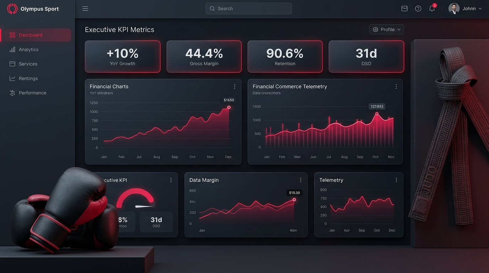
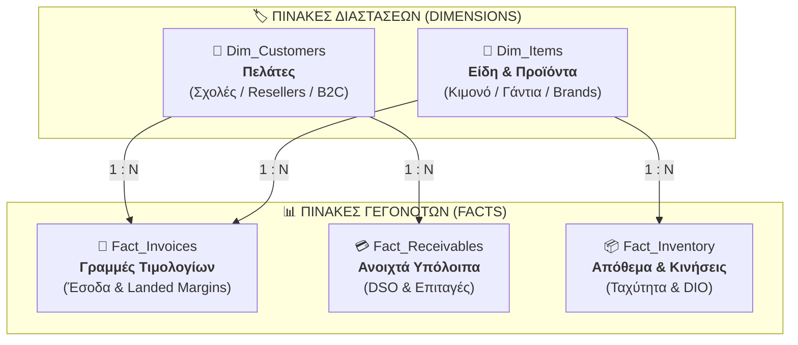
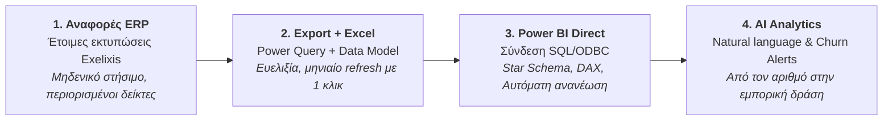

# 🥋 Olympus Sport Hellas — B2B & B2C Commercial Intelligence & ERP KPI Hub

<div align="center">

[](https://karidasd.github.io/erp-kpi-hub/)

[](https://react.dev/)
[](https://www.typescriptlang.org/)
[](https://vitejs.dev/)
[](https://tailwindcss.com/)
[](LICENSE)
[](#)

<br/><br/>



<br/>

**Ολοκληρωμένο Σύστημα Ανάλυσης Πωλήσεων, Δεικτών Απόδοσης (29 KPIs) & Αρχιτεκτονικής Star Schema**  
*Ειδικά σχεδιασμένο για εισαγωγικές & εμπορικές επιχειρήσεις B2B (χονδρική σε dojo, σχολές πολεμικών τεχνών, resellers, ομοσπονδίες) και B2C (καταστήματα λιανικής & e-shop).*

👉 **[Δοκιμάστε την εφαρμογή ζωντανά: https://karidasd.github.io/erp-kpi-hub/](https://karidasd.github.io/erp-kpi-hub/)**

</div>

---

## 📖 Περιεχόμενα
1. [Επισκόπηση & Επιχειρηματικό Πλαίσιο](#-επισκόπηση--επιχειρηματικό-πλαίσιο)
2. [Μέρος Α: Θεμέλια Δεδομένων & Αρχές](#-μέρος-α-θεμέλια-δεδομένων--αρχές)
   - [Αρχιτεκτονική Star Schema](#αρχιτεκτονική-star-schema)
   - [Προδιαγραφές Πινάκων](#προδιαγραφές-πινάκων-star-schema)
   - [Λογιστικές Αρχές (ΕΛΠ, ΦΠΑ, Landed Cost, Markup vs Margin)](#λογιστικές-αρχές-ελπ-ν-43082014--mydata)
   - [Στατιστικές Αρχές (Ασυμμετρία, Εποχικότητα, Παράδοξο Simpson)](#στατιστικές-αρχές)
3. [Μέρος Β: Συνοπτικός Πίνακας των 29 Δεικτών](#-μέρος-β-συνοπτικός-πίνακας-των-29-δεικτών)
4. [Αναλυτική Παρουσίαση των 7 Βασικών Δεικτών Εκκίνησης](#-αναλυτική-παρουσίαση-των-7-βασικών-δεικτών)
5. [Μέρος Γ: Υλοποίηση, Αυτοματισμός & Ερωτήσεις ERP Exelixis](#-μέρος-γ-υλοποίηση--αυτοματισμός)
   - [Τέσσερα Επίπεδα Αυτοματοποίησης](#τέσσερα-επίπεδα-αυτοματοποίησης)
   - [Πλάνο Υλοποίησης 12 Εβδομάδων](#πλάνο-υλοποίησης-12-εβδομάδων)
   - [Data Health Check (Έλεγχος Ποιότητας Δεδομένων)](#data-health-check-έλεγχος-ποιότητας-δεδομένων)
   - [Ερωτήσεις προς την Εταιρεία του ERP (Exelixis)](#οι-6-τεχνικές-ερωτήσεις-προς-την-exelixis)
6. [🔌 Plugin Architecture & Ενσωμάτωση σε Άλλες Εφαρμογές](#-plugin-architecture--ενσωμάτωση-σε-άλλες-εφαρμογές)
7. [🧮 Live Προσομοιωτές στην Εφαρμογή](#-live-προσομοιωτές-στην-εφαρμογή)
8. [Βιβλιογραφία & Πηγές Εμβάθυνσης](#-βιβλιογραφία--πηγές-εμβάθυνσης)
9. [Οδηγός Εγκατάστασης & Εκτέλεσης](#-οδηγός-εγκατάστασης--εκτέλεσης)

---

## 🥋 Επισκόπηση & Επιχειρηματικό Πλαίσιο

Στην εμπορία αθλητικού εξοπλισμού και πολεμικών τεχνών (**Olympus Sport Hellas**), οι αποφάσεις συχνά λαμβάνονται με βάση «αίσθηση» ή απλό τζίρο τιμολογίων. Η προσέγγιση αυτή κρύβει σημαντικούς κινδύνους:
* **Έντονη εποχικότητα:** Ο Σεπτέμβριος και ο Ιανουάριος παρουσιάζουν τεράστιες αιχμές (έναρξη σχολικής και αθλητικής σεζόν), ενώ ο Αύγουστος γνωρίζει φυσική κάμψη.
* **Μεγάλο Lead Time:** Εισαγωγές κιμονό (Judo/Karate/BJJ) και γαντιών από εργοστάσια του εξωτερικού (π.χ. Πακιστάν) απαιτούν 8+ εβδομάδες μεταφοράς.
* **Κίνδυνος Price Leakage:** Σιωπηρή διόγκωση εκπτώσεων σε φιλικές σχέσεις με σχολές και dojo.
* **Δέσμευση Ρευστότητας:** Οι μεταχρονολογημένες επιταγές μηδενίζουν λογιστικά το υπόλοιπο πελάτη, αλλά δεσμεύουν πραγματικό κεφάλαιο κίνησης.

Η παρούσα εφαρμογή μετατρέπει τις **29 μεθοδολογικές καρτέλες** του εσωτερικού οδηγού σε ένα ζωντανό ψηφιακό εργαλείο διαχείρισης.

---

## 🏛️ Μέρος Α: Θεμέλια Δεδομένων & Αρχές

### Αρχιτεκτονική Star Schema

Η αρχιτεκτονική διαχωρίζει τις συναλλαγές (**Fact Tables**) από τα χαρακτηριστικά κατηγοριοποίησης (**Dimension Tables**) με σχέσεις **1 : N** για άμεση αξιοποίηση σε **Power BI (DAX)**, **Excel Power Query** και SQL βάσεις:



### Προδιαγραφές Πινάκων Star Schema

#### 1. Πίνακες Γεγονότων (Fact Tables)
| Πίνακας | Περιεχόμενο | Απαραίτητες Στήλες | Τροφοδοτεί KPIs |
| :--- | :--- | :--- | :--- |
| **`Fact_Invoices`** | Γραμμές πωλήσεων / τιμολογίων | Ημερομηνία, Αρ. & τύπος παραστατικού, Κατάστημα, Κωδ. πελάτη, Κωδ. είδους, Ποσότητα, Τιμή καταλόγου, Έκπτωση %, Καθαρή αξία, **Κόστος γραμμής (Landed Cost)**, Πωλητής | Έσοδα, Margins, PVM, Πελάτες, B2C |
| **`Fact_Receivables`** | Ανοιχτά υπόλοιπα πελατών | Κωδ. πελάτη, Παραστατικό, Ημ. έκδοσης, Ημ. λήξης πιστωτικού ορίου, Υπόλοιπο (με ΦΠΑ), **Επιταγές χαρτοφυλακίου** | DSO, Ενηλικίωση, Επισφάλειες |
| **`Fact_Inventory`** | Απόθεμα & κινήσεις αποθήκης | Κωδ. είδους, Αποθήκη, Ποσότητα, **Κόστος μονάδας Landed**, Ημερομηνία στιγμιότυπου, Παραλαβές | Ταχύτητα, DIO, GMROI, Sell-through, Safety Stock |

#### 2. Πίνακες Διαστάσεων (Dimension Tables)
| Πίνακας | Περιεχόμενο | Απαραίτητες Στήλες | Τροφοδοτεί KPIs |
| :--- | :--- | :--- | :--- |
| **`Dim_Customers`** | Στοιχεία πελατολογίου | Κωδικός πελάτη, Επωνυμία, ΑΦΜ, Χώρα, Τύπος (Σχολή / Γυμναστήριο / Reseller / Ομοσπονδία / B2C), Ημ. δημιουργίας, Όροι πίστωσης | Τμηματοποίηση όλων των δεικτών |
| **`Dim_Items`** | Στοιχεία ειδών & εξοπλισμού | Κωδικός είδους, Περιγραφή, Κατηγορία, Άθλημα (Judo, Karate, Boxing κ.λπ.), Brand (Olympus, Hayashi κ.λπ.), Προμηθευτής, Lead Time παράδοσης | Ανάλυση ανά κατηγορία, brand & άθλημα |

> [!IMPORTANT]
> **Η κρίσιμη στήλη:** Το **«Κόστος γραμμής» (Landed Cost)**. Αν το export του ERP δεν τη δίνει, όλοι οι δείκτες κερδοφορίας και αποθέματος υπολογίζονται αναγκαστικά με σύνδεση στο τρέχον κόστος, το οποίο είναι ανακριβές για παλαιότερες περιόδους.

---

### Λογιστικές Αρχές (ΕΛΠ ν. 4308/2014 & myDATA)

1. **Καθαρά ποσά χωρίς ΦΠΑ:** Τα έσοδα της Γενικής Λογιστικής είναι **χωρίς ΦΠΑ**. Αντίθετα, τα υπόλοιπα πελατών, οι αποδείξεις λιανικής και τα dashboards ψηφιακών διαφημίσεων (Meta/Google Pixel) περιλαμβάνουν ΦΠΑ $24\%$. Οποιοσδήποτε δείκτης αναμιγνύει τις δύο βάσεις παράγει σφάλμα $+24\%$.
2. **Δεδουλευμένη έναντι Ταμειακής βάσης:** Η πώληση αναγνωρίζεται με το τιμολόγιο (δεδουλευμένη), η είσπραξη με την πληρωμή (ταμειακή). Η διαφορά τους ισούται ακριβώς με το **κεφάλαιο κίνησης**.
3. **Κόστος Κτήσης (Landed Cost):** Κατά τα ΕΛΠ, το κόστος των εμπορευμάτων περιλαμβάνει τιμή αγοράς τιμολογίου προμηθευτή, μεταφορικά ναύλα, δασμούς και άμεσα έξοδα κτήσης. Για αγορές σε USD εφαρμόζεται η ισοτιμία της ημέρας συναλλαγής.
4. **Markup vs Margin:**
   * $\text{Markup} = \frac{\text{Τιμή Πώλησης} - \text{Κόστος}}{\text{Κόστος}}$ (επί του κόστους).
   * $\text{Margin} = \frac{\text{Τιμή Πώλησης} - \text{Κόστος}}{\text{Τιμή Πώλησης}}$ (επί της πώλησης).
   * Ο κανόνας τιμολόγησης $\times 1{,}80$ ισοδυναμεί με **Markup $80\%$**, που αντιστοιχεί σε **Μικτό Περιθώριο (Margin) $44{,}4\%$** ($\frac{0{,}80}{1{,}80}$).
5. **Κόστος Πωληθέντων (ΚΠΑ):**  
   $$\text{ΚΠΑ} = \text{Αρχικό Απόθεμα} + \text{Αγορές} - \text{Τελικό Απόθεμα}$$

---

### Στατιστικές Αρχές

* **Μέσος και Διάμεσος:** Οι πωλήσεις έχουν δεξιά ασύμμετρη κατανομή (λίγοι μεγάλοι resellers και πολλοί μικροί πελάτες). Ένας μεγάλος πελάτης μετακινεί μόνος του τον μέσο όρο. Παρουσιάζονται **πάντα και οι δύο αριθμοί**.
* **Εποχικότητα:** Σύγκριση πάντα «ίδιος μήνας με ίδιο μήνα πέρσι» ή με κυλιόμενα 12μηνα.
* **Μικροί Παρονομαστές:** Δίπλα σε κάθε ποσοστό μεταβολής εμφανίζεται πάντα το απόλυτο νούμερο (το $+50\%$ μπορεί να σημαίνει απλώς $6$ αντί για $4$ πελάτες).
* **Σταθμισμένοι Μέσοι:** Ο απλός μέσος όρος εκπτώσεων δίνει το ίδιο βάρος σε έκπτωση $50\%$ για κορδόνια $2 \text{ €}$ και σε έκπτωση $5\%$ για παραγγελία $5.000 \text{ €}$. Υπολογισμός πάντα ως $\frac{\sum \text{Αριθμητών}}{\sum \text{Παρονομαστών}}$.
* **Παράδοξο του Simpson:** Το συνολικό margin μπορεί να πέφτει ενώ κάθε κατηγορία ξεχωριστά ανεβαίνει, αν το μείγμα στραφεί σε φθηνότερα προϊόντα. Προστασία μέσω **PVM**.

---

## 📊 Μέρος Β: Συνοπτικός Πίνακας των 29 Δεικτών

| # | Δείκτης | Αγγλικός Όρος | Κατηγορία | Κοινό | Βασικός | Υλοποίηση |
|:-:|:---|:---|:---|:---:|:---:|:---|
| **01** | **Αύξηση πωλήσεων σε ετήσια βάση** | Revenue growth YoY | Έσοδα | B2B · B2C | ⭐ | Πιθανώς έτοιμο στο ERP |
| **02** | **Πωλήσεις έναντι στόχου (Run-rate)** | Sales vs target | Έσοδα | B2B · B2C | | Export από ERP + Excel/BI |
| **03** | **Ανάλυση τιμής-όγκου-μείγματος** | Price-volume-mix (PVM) | Έσοδα | B2B | ⭐ | Export από ERP + Excel/BI |
| **04** | **Ποσοστό μικτού κέρδους** | Gross margin % | Κερδοφορία | B2B · B2C | ⭐ | Πιθανώς έτοιμο στο ERP |
| **05** | **Μέση έκπτωση (Price leakage)** | Average discount % | Κερδοφορία | B2B | | Export από ERP + Excel/BI |
| **06** | **Κερδοφορία ανά πελάτη** | Cost-to-serve / Whale curve | Κερδοφορία | B2B | | Export από ERP + Excel/BI |
| **07** | **Ενεργοί πελάτες** | Active customers | Πελάτες | B2B | | Export από ERP + Excel/BI |
| **08** | **Ποσοστό διατήρησης πελατών** | Customer retention (CRR/NRR) | Πελάτες | B2B | ⭐ | Export από ERP + Excel/BI |
| **09** | **Σιωπηλή αποχώρηση** | Silent churn / inactivity alert | Πελάτες | B2B | | Export από ERP + Excel/BI |
| **10** | **Μέση αξία παραγγελίας** | Average order value (AOV) | Πελάτες | B2B · B2C | | Πιθανώς έτοιμο στο ERP |
| **11** | **Συχνότητα παραγγελιών** | Order frequency | Πελάτες | B2B | | Export από ERP + Excel/BI |
| **12** | **Αξία πελάτη στον χρόνο ζωής** | Customer lifetime value (CLV) | Πελάτες | B2B · B2C | | Export από ERP + Excel/BI |
| **13** | **Συγκέντρωση πελατών (Pareto/HHI)** | Customer concentration | Πελάτες | B2B | ⭐ | Export από ERP + Excel/BI |
| **14** | **Τμηματοποίηση RFM** | RFM segmentation | Πελάτες | B2B · B2C | | Export από ERP + Excel/BI |
| **15** | **Μέση διάρκεια είσπραξης** | Days sales outstanding (DSO) | Ταμείο | B2B | ⭐ | Export από ERP + Excel/BI |
| **16** | **Ενηλικίωση απαιτήσεων** | Accounts receivable aging | Ταμείο | B2B | | Πιθανώς έτοιμο στο ERP |
| **17** | **Ποσοστό επισφαλειών & ECL** | Expected credit loss | Ταμείο | B2B | | Export από ERP + Excel/BI |
| **18** | **Κυκλοφοριακή ταχύτητα αποθέματος** | Inventory turnover | Απόθεμα | B2B · B2C | | Export από ERP + Excel/BI |
| **19** | **Ημέρες αποθέματος** | Days inventory outstanding (DIO)| Απόθεμα | B2B · B2C | | Export από ERP + Excel/BI |
| **20** | **Μικτό κέρδος ανά € αποθέματος** | GMROI | Απόθεμα | B2B · B2C | ⭐ | Export από ERP + Excel/BI |
| **21** | **Ρυθμός διάθεσης παρτίδας & ABC/XYZ**| Sell-through rate | Απόθεμα | B2B · B2C | | Export από ERP + Excel/BI |
| **22** | **Πλήρης εκτέλεση & Safety Stock** | Fill rate & safety stock | Απόθεμα | B2B | | Export από ERP + Excel/BI |
| **23** | **Μετατροπή προσφορών** | Quote-to-order rate | Pipeline | B2B | | Χρειάζεται δεδομένα εκτός ERP |
| **24** | **Νέοι πελάτες & Κόστος απόκτησης**| CAC & CLV:CAC ratio | Pipeline | B2B · B2C | | Χρειάζεται δεδομένα εκτός ERP |
| **25** | **Διάρκεια κύκλου πώλησης** | Sales cycle length | Pipeline | B2B | | Χρειάζεται δεδομένα εκτός ERP |
| **26** | **Ποσοστό μετατροπής** | Conversion rate | B2C | B2C | | Χρειάζεται δεδομένα εκτός ERP |
| **27** | **Αξία καλαθιού & UPT** | ATV, UPT & Attach rate | B2C | B2C | | Πιθανώς έτοιμο στο ERP |
| **28** | **Ποσοστό επιστροφών** | Return rate | B2C | B2B · B2C | | Πιθανώς έτοιμο στο ERP |
| **29** | **Απόδοση διαφήμισης (ROAS/POAS)** | ROAS & Break-even ROAS | B2C | B2C | | Χρειάζεται δεδομένα εκτός ERP |

---

## ⭐ Αναλυτική Παρουσίαση των 7 Βασικών Δεικτών

<details open>
<summary><b>📈 01. Αύξηση πωλήσεων σε ετήσια βάση (Revenue Growth YoY)</b></summary>
<br>

* **Τι μετράει:** Ο ρυθμός μεταβολής των πωλήσεων μιας περιόδου σε σχέση με την ίδια περίοδο του προηγούμενου έτους. Η σύγκριση «ίδιος μήνας με ίδιο μήνα» αφαιρεί την εποχικότητα: στις πολεμικές τέχνες ο Σεπτέμβριος και ο Ιανουάριος είναι πάντα δυνατοί λόγω σχολικής χρονιάς, οπότε η σύγκριση Σεπτεμβρίου με Αύγουστο δεν λέει τίποτα.
* **Μαθηματικός Τύπος:**
  $$\text{Αύξηση YoY} = \frac{\text{Πωλήσεις}_t - \text{Πωλήσεις}_{t-12}}{\text{Πωλήσεις}_{t-12}} \quad | \quad \text{CAGR} = \left(\frac{\text{Πωλήσεις}_{\text{τέλος}}}{\text{Πωλήσεις}_{\text{αρχή}}}\right)^{1/n} - 1$$
* **Λογιστική Βάση:** Καθαρές πωλήσεις: λογαριασμοί πωλήσεων (ομάδα 70) μείον επιστροφές και εκπτώσεις (πιστωτικά), χωρίς ΦΠΑ. Δεδουλευμένη βάση. Συμφωνία με myDATA.
* **Υλοποίηση:** Excel Pivot με Γραμμές = Μήνας, Στήλες = Έτος, Τιμές = Καθαρή αξία $\rightarrow$ «Εμφάνιση τιμών ως: % διαφορά από προηγούμενο έτος».
* **Παράδειγμα:** Οκτώβριος 2025: $48.000 \text{ €}$. Οκτώβριος 2026: $52.800 \text{ €}$. Αύξηση $\text{YoY} = \frac{4.800}{48.000} = \mathbf{+10\%}$.
* **Παγίδα:** Η αύξηση μπορεί να προέρχεται μόνο από αύξηση τιμοκαταλόγου ενώ οι ποσότητες πέφτουν. Συνδυάζεται με PVM.
</details>

<details>
<summary><b>💰 04. Ποσοστό μικτού κέρδους (Gross Margin %)</b></summary>
<br>

* **Τι μετράει:** Το ποσοστό κάθε ευρώ πωλήσεων που απομένει μετά την αφαίρεση του κόστους εμπορευμάτων.
* **Μαθηματικός Τύπος:**
  $$\text{Margin} = \frac{\text{Καθαρές πωλήσεις} - \text{Κόστος πωληθέντων}}{\text{Καθαρές πωλήσεις}} \quad | \quad \text{Margin} = \frac{k}{1+k} \text{ (όπου } k = \text{Markup)}$$
* **Λογιστική Βάση:** Κόστος πωληθέντων (ΚΠΑ) κατά ΕΛΠ (ν. 4308/2014) περιλαμβάνει τιμή αγοράς, μεταφορικά, δασμούς (Landed Cost).
* **Παράδειγμα:** Γάντια με Landed Cost $25 \text{ €} \rightarrow$ Χονδρική $45 \text{ €} \rightarrow \text{Margin } \frac{20}{45} = \mathbf{44{,}4\%}$. Με έκπτωση $10\%$ (τιμή $40{,}50 \text{ €}$) $\rightarrow \text{Margin } \frac{15{,}50}{40{,}50} = \mathbf{38{,}3\%}$.
* **Παγίδα:** Αν στο ERP το κόστος του είδους είναι μόνο η τιμή τιμολογίου του προμηθευτή, χωρίς μεταφορικά και δασμούς, το margin εμφανίζεται πλασματικά υπερεκτιμημένο!
</details>

<details>
<summary><b>⚖️ 03. Ανάλυση τιμής-όγκου-μείγματος (Price-Volume-Mix / PVM)</b></summary>
<br>

* **Τι μετράει:** Αναλύει τη μεταβολή των εσόδων σε τρεις αιτίες: τιμή, όγκο και μείγμα. Προστατεύει από το παράδοξο του Simpson.
* **Μαθηματικός Τύπος:**
  $$\text{Επίδραση Τιμής} = \sum (P1_i - P0_i) \times Q1_i$$
  $$\text{Επίδραση Όγκου} = (\sum Q1 - \sum Q0) \times P0_{\text{μέσο}}$$
  $$\text{Επίδραση Μείγματος} = \sum (P0_i \times Q1_i) - \sum Q1 \times P0_{\text{μέσο}}$$
  $$\text{Έλεγχος Συμφωνίας:} \quad \text{Τιμή} + \text{Όγκος} + \text{Μείγμα} = \text{Έσοδα}_1 - \text{Έσοδα}_0$$
* **Παράδειγμα:** Γάντια: $P0=40\text{€}, Q0=100 \rightarrow P1=42\text{€}, Q1=80$. Bandages: $P0=5\text{€}, Q0=100 \rightarrow P1=5\text{€}, Q1=160$. Έσοδα $4.500 \rightarrow 4.160 \text{ €} (-340 \text{ €})$. Τιμή $= +160 \text{ €}$, Όγκος $= +900 \text{ €}$, Μείγμα $= \mathbf{-1.400 \text{ €}}$. Πουλήθηκαν περισσότερα τεμάχια, αλλά το μείγμα στράφηκε προς φθηνά είδη!
</details>

<details>
<summary><b>🔄 08. Ποσοστό διατήρησης πελατών (Customer Retention Rate - CRR & NRR)</b></summary>
<br>

* **Τι μετράει:** Το ποσοστό πελατών μιας περιόδου που αγόρασαν ξανά στην επόμενη.
* **Μαθηματικός Τύπος:**
  $$\text{CRR} = \frac{E - N}{S} \quad | \quad \text{NRR} = \frac{\text{Έσοδα φέτος από περσινούς πελάτες}}{\text{Έσοδα πέρσι από τους ίδιους}}$$
* **Παράδειγμα:** $S = 320, E = 335, N = 45$. $\text{CRR} = \frac{335 - 45}{320} = \mathbf{90{,}6\%}$ (αποχώρηση $9{,}4\%$).
* **Παγίδα:** Ο αριθμός πελατών μπορεί να μένει σταθερός ενώ χάνονται μεγάλοι resellers και αντικαθίστανται από μικρούς. Παρακολουθείται πάντα και το NRR σε αξία.
</details>

<details>
<summary><b>🎯 13. Συγκέντρωση πελατών (Customer Concentration & HHI)</b></summary>
<br>

* **Τι μετράει:** Πόσο εξαρτώνται τα έσοδα από λίγους πελάτες (μέτρο ρίσκου).
* **Μαθηματικός Τύπος:**
  $$\text{Μερίδιο Top-N} = \frac{\text{Πωλήσεις των } N \text{ μεγαλύτερων}}{\text{Συνολικές Πωλήσεις}} \quad | \quad \text{HHI} = \sum s_i^2 \quad (s_i = \text{μερίδιο σε \%})$$
* **Παράδειγμα:** Αν ο μεγαλύτερος πελάτης έχει $18\%$ και οι επόμενοι 9 μαζί $22\%$, το μερίδιο Top-10 είναι $40\%$. Μόνο ο πρώτος συνεισφέρει $18^2 = 324$ μονάδες στο HHI.
</details>

<details>
<summary><b>⏱️ 15. Μέση διάρκεια είσπραξης (Days Sales Outstanding - DSO)</b></summary>
<br>

* **Τι μετράει:** Πόσες ημέρες μεσολαβούν από την πώληση μέχρι την είσπραξη μετρητών.
* **Μαθηματικός Τύπος:**
  $$\text{DSO} = \frac{\text{Υπόλοιπο Πελατών}}{\text{Πωλήσεις επί πιστώσει (με ΦΠΑ)}} \times \text{Ημέρες Περιόδου}$$
  $$\text{Κύκλος Μετατροπής Μετρητών (CCC)} = \text{DIO} + \text{DSO} - \text{DPO}$$
* **Κρίσιμο Σημείο:** Το υπόλοιπο πελατών (ομάδα 30) περιλαμβάνει ΦΠΑ $24\%$. Αν διαιρεθεί με καθαρές πωλήσεις, το DSO βγαίνει $24\%$ μεγαλύτερο. Επίσης, προστίθενται οι μεταχρονολογημένες επιταγές (ομάδα 33) για το **οικονομικό DSO**.
* **Παράδειγμα:** Υπόλοιπο $186.000 \text{ €}$ (με ΦΠΑ). Πωλήσεις τριμήνου $450.000 \text{ €}$ καθαρά ($558.000 \text{ €}$ με ΦΠΑ). $\text{DSO} = \frac{186}{558} \times 92 = \mathbf{31 \text{ ημέρες}}$. Με επιταγές $90.000 \text{ €}$, το πραγματικό οικονομικό DSO γίνεται $\mathbf{46 \text{ ημέρες}}$.
</details>

<details>
<summary><b>📦 20. Μικτό κέρδος ανά € αποθέματος (GMROI)</b></summary>
<br>

* **Τι μετράει:** Πόσα ευρώ μικτού κέρδους παράγει τον χρόνο κάθε ευρώ που είναι δεμένο σε απόθεμα.
* **Μαθηματικός Τύπος:**
  $$\text{GMROI} = \frac{\text{Μικτό Κέρδος}}{\text{Μέσο Απόθεμα (σε κόστος)}} = \left[\frac{m}{1-m}\right] \times \text{Ταχύτητα Αποθέματος}$$
* **Παράδειγμα:** Κατηγορία Α (Margin $50\%$, Ταχύτητα $1$) $\rightarrow \text{GMROI } \mathbf{1{,}0}$. Κατηγορία Β (Margin $30\%$, Ταχύτητα $4$) $\rightarrow \text{GMROI } \mathbf{1{,}71}$. Η «φθηνή» κατηγορία αποδίδει $+71\%$ περισσότερο ανά ευρώ κεφαλαίου!
</details>

---

## 🛠️ Μέρος Γ: Υλοποίηση & Αυτοματισμός

### Τέσσερα Επίπεδα Αυτοματοποίησης



---

### Πλάνο Υλοποίησης 12 Εβδομάδων

| Φάση | Εβδομάδες | Κύριο Παραδοτέο | Δείκτες που Καλύπτονται |
|:---|:---:|:---|:---|
| **1. Δεδομένα & Θεμέλια** | **1–2** | Τα 5 exports, έλεγχος ποιότητας, γραπτό λεξικό ορισμών (data dictionary). | — |
| **2. Βασικός Πίνακας** | **3–4** | Excel με Power Query: μηνιαίο dashboard των 7 βασικών δεικτών. | YoY, Margin, PVM, Retention, Συγκέντρωση, DSO, GMROI |
| **3. Πελάτες & Ταμείο** | **5–8** | Εβδομαδιαία λίστα σιωπηλής αποχώρησης, RFM segmentation, ενηλικίωση, κερδοφορία ανά πελάτη. | Silent Churn, RFM, Aging, ECL, Cost-to-serve |
| **4. Απόθεμα & Αυτοματισμός** | **9–12** | Power BI με αυτόματη ανανέωση. ABC/XYZ και σημεία αναπαραγγελίας για εισαγόμενους κωδικούς. | Ταχύτητα, DIO, Sell-through, Fill Rate, Safety Stock |

---

### Data Health Check (Έλεγχος Ποιότητας Δεδομένων)
Πριν από κάθε υπολογισμό, ελέγχονται τα εξής 5 σημεία:
* [ ] **Κόστος:** Περιλαμβάνει το κόστος των ειδών στο ERP μεταφορικά, δασμούς και συναλλαγματικές διαφορές (Landed Cost);
* [ ] **Κωδικοί:** Υπάρχουν κωδικοί που αντιστοιχούν σε διαφορετικά προϊόντα ή ίδια προϊόντα με πολλούς κωδικούς; (Στον κατάλογο 2027-28 βρέθηκαν τέτοιες περιπτώσεις).
* [ ] **Πελάτες:** Υπάρχουν διπλοεγγραφές του ίδιου πελάτη (ίδιο ΑΦΜ, διαφορετικός κωδικός);
* [ ] **Κατηγοριοποίηση:** Έχουν όλοι οι πελάτες τύπο (σχολή / γυμναστήριο / reseller) και όλα τα είδη κατηγορία και brand;
* [ ] **Συμφωνία:** Το σύνολο του export γραμμών συμφωνεί με το ισοζύγιο των εσόδων της ίδιας περιόδου στη Γενική Λογιστική (myDATA);

---

### Οι 6 Τεχνικές Ερωτήσεις προς την Exelixis
1. Υπάρχει BI module ή έτοιμη σύνδεση με Power BI;
2. Μπορούμε να έχουμε read-only πρόσβαση στη βάση δεδομένων (SQL/ODBC);
3. Μπορεί να γίνει export γραμμών τιμολογίων με κόστος ανά γραμμή (landed cost), τιμή καταλόγου και έκπτωση, ιδανικά προγραμματισμένο;
4. Υπάρχει αναφορά ενηλικίωσης απαιτήσεων με βάση την ημερομηνία λήξης;
5. Κρατά το σύστημα ιστορικό αξίας αποθέματος ανά μήνα, ή μόνο την τρέχουσα εικόνα;
6. Υποστηρίζει παραστατικά προσφοράς και παραγγελίας πελάτη με μετασχηματισμό σε τιμολόγιο;

---

## 🔌 Plugin Architecture & Ενσωμάτωση σε Άλλες Εφαρμογές

Η εφαρμογή σχεδιάστηκε εξαρχής με **αρθρωτή αρχιτεκτονική (modular plugin architecture)**, ώστε ο μαθητής σας ή οποιοσδήποτε προγραμματιστής να μπορεί να ενσωματώσει τον μηχανισμό υπολογισμών σε οποιαδήποτε άλλη εφαρμογή (React, Vue, Angular, Node.js backend, ERP portal ή CRM):

### 1. Αυτόνομη Βιβλιοθήκη Υπολογισμών (Core SDK)
Όλοι οι μαθηματικοί και λογιστικοί υπολογισμοί βρίσκονται απομονωμένοι στον φάκελο [`src/core/kpiEngine.ts`](src/core/kpiEngine.ts) ως pure functions χωρίς καμία εξάρτηση από το React ή γραφικά στοιχεία.

```typescript
import { 
  calculatePVM, 
  calculateLandedCost, 
  calculateGrossMargin, 
  calculateDSO, 
  evaluateSilentChurn,
  calculateSafetyStockAndROP 
} from './src/core/kpiEngine';

// 1. Υπολογισμός Landed Cost (ΕΛΠ) & Gross Margin %
const landedCost = calculateLandedCost(20, 25); // 20€ CIF + 25% έξοδα = 25.00€
const margin = calculateGrossMargin(45, landedCost); // 44.44%

// 2. Έλεγχος Σιωπηλής Αποχώρησης Πελάτη (Silent Churn)
const alert = evaluateSilentChurn(75, 40); // 75 μέρες αποχής / 40 μέρες κύκλος
console.log(alert.status); // "At Risk" (Δείκτης 1.88x)
console.log(alert.actionGreek); // "Σε κίνδυνο: Άμεση τηλεφωνική επικοινωνία από πωλητή"

// 3. PVM Decomposition Waterfall
const pvm = calculatePVM([
  { code: 'GLV-10', p0: 40, q0: 100, p1: 42, q1: 80 },
  { code: 'BAND-4M', p0: 5, q0: 100, p1: 5, q1: 160 }
]);
console.log(pvm.mixEffect); // -1400€ (Στροφή σε φθηνότερα είδη)
console.log(pvm.reconciliationCheck); // true (Απόλυτος έλεγχος συμφωνίας)
```

---

### 2. Embeddable Widget / IFrame Mode (Ενσωμάτωση με 1 Γραμμή Κώδικα)
Η εφαρμογή υποστηρίζει **ειδικό Embed Mode** μέσω URL parameters. Όταν καλείται με `?embed=true`, αφαιρούνται αυτόματα το header και το footer και προβάλλεται καθαρά το ζητούμενο widget:

```html
<!-- Ενσωμάτωση των Live Προσομοιωτών σε εξωτερικό CRM / ERP -->
<iframe 
  src="https://karidasd.github.io/erp-kpi-hub/?embed=true&tab=calculators" 
  width="100%" 
  height="750px" 
  frameborder="0"
  style="border-radius: 12px; border: 1px solid #334155;">
</iframe>
```

* **Παράμετροι URL:**
  * `?embed=true`: Αποκρύπτει πλοήγηση και υποσέλιδο.
  * `&tab=dashboard`: Προβάλλει απευθείας το Executive Dashboard.
  * `&tab=calculators`: Προβάλλει απευθείας τους 5 live υπολογιστές.
  * `&tab=catalog`: Προβάλλει τον διαδραστικό κατάλογο των 29 δεικτών.

---

### 3. Exelixis ERP Data Adapter & Normalizer
Στο αρχείο [`src/core/exelixisAdapter.ts`](src/core/exelixisAdapter.ts) περιλαμβάνεται κανονικοποιητής (adapter) που διαβάζει τα ελληνικά exports του ERP (Exelixis, SoftOne, Entersoft) και τα μετατρέπει αυτόματα στο Star Schema:
* Αυτόματη αναγνώριση στηλών στα ελληνικά (*«Καθαρή Αξία», «Κόστος Γραμμής», «Επωνυμία», «ΑΦΜ»* κ.λπ.).
* Αυτόματος υπολογισμός καθαρών ποσών χωρίς ΦΠΑ.
* Εντοπισμός ελλείψεων σε Landed Cost και επιστροφή τεχνικών προειδοποιήσεων (warnings).

---

### 4. Εξαγωγή Επίσημης Αναφοράς Διοίκησης σε PDF (1-Click Management Brief)
Στην εφαρμογή υπάρχει ενσωματωμένο σύστημα έκδοσης **Executive Report**:
* Πατώντας το κουμπί **«Αναφορά PDF»** ανοίγει ένα καθαρό, εκτυπώσιμο 2σέλιδο δελτίο διοίκησης.
* Έτοιμο για απευθείας εκτύπωση ή αποθήκευση σε PDF (`window.print()`) με ειδικό print stylesheet (λευκό φόντο, μαύρα γράμματα, εταιρικό επιστολόχαρτο, πίνακας 7 Core KPIs, ανάλυση επιταγών/DSO και λίστα πελατών σε κίνδυνο).

---

### 5. Machine-Readable Open Data Dictionary (`/kpis.json`)
Όλοι οι 29 δείκτες, οι μαθηματικοί τους τύποι, οι κανόνες ΕΛΠ και τα standards υλοποίησης διατίθενται ως ανοιχτό JSON endpoint:
* **Διαδρομή:** [`public/kpis.json`](public/kpis.json)
* Επιτρέπει σε τρίτες εφαρμογές, mobile apps ή AI agents να αντλούν δυναμικά το επίσημο λεξικό ορισμών (Data Dictionary).

---

## 🧮 Live Προσομοιωτές στην Εφαρμογή

1. **PVM Analyzer:** Αυτόματη αποδόμηση της μεταβολής τζίρου συγκρίνοντας περιόδους με έλεγχο συμφωνίας.
2. **Markup ↔ Gross Margin & Landed Cost:** Υπολογισμός πραγματικού κόστους κτήσης και απαιτούμενης αύξησης όγκου $\frac{d}{m-d}$ όταν δίνεται έκπτωση.
3. **DSO & Cash Conversion Cycle (CCC):** Διόρθωση με ΦΠΑ $24\%$ και υπολογισμός ημερών δέσμευσης με επιταγές.
4. **Safety Stock & ROP:** Επιστημονικό απόθεμα ασφαλείας $z \times \sigma_d \times \sqrt{L}$ και σημείο παραγγελίας.
5. **Silent Churn Detector:** Εντοπισμός πελατών σε κίνδυνο βάσει του προσωπικού τους ιστορικού κύκλου.

---

## 📚 Βιβλιογραφία & Πηγές Εμβάθυνσης

* **Ν. 4308/2014:** Ελληνικά Λογιστικά Πρότυπα (αποτίμηση αποθεμάτων, απομείωση απαιτήσεων).
* **Kaplan, R. & Anderson, S.:** *Time-Driven Activity-Based Costing* (κερδοφορία πελατών, cost-to-serve, καμπύλη φάλαινας).
* **Fader, P., Hardie, B. & Lee, K. (2005):** *«Counting Your Customers the Easy Way»*, Marketing Science (μοντέλο BG/NBD για σιωπηλή αποχώρηση).
* **Gupta, S. & Lehmann, D. (2003):** *«Customers as Assets»*, Journal of Interactive Marketing (τύπος CLV).
* **Marn, M. & Rosiello, R. (1992):** *«Managing Price, Gaining Profit»*, Harvard Business Review (price waterfall).
* **Silver, E., Pyke, D. & Thomas, D.:** *Inventory and Production Management in Supply Chains* (απόθεμα ασφαλείας, service levels).

---

## 💻 Οδηγός Εγκατάστασης & Εκτέλεσης

```bash
# 1. Κλωνοποίηση του αποθετηρίου
git clone https://github.com/karidasd/erp-kpi-hub.git
cd erp-kpi-hub

# 2. Εγκατάσταση εξαρτήσεων
npm install

# 3. Εκκίνηση τοπικού server
npm run dev
```

Ανοίξτε στον browser τη διεύθυνση: `http://localhost:5173`

---

## 📄 Άδεια Χρήσης
Διανέμεται υπό την άδεια [MIT License](LICENSE).
